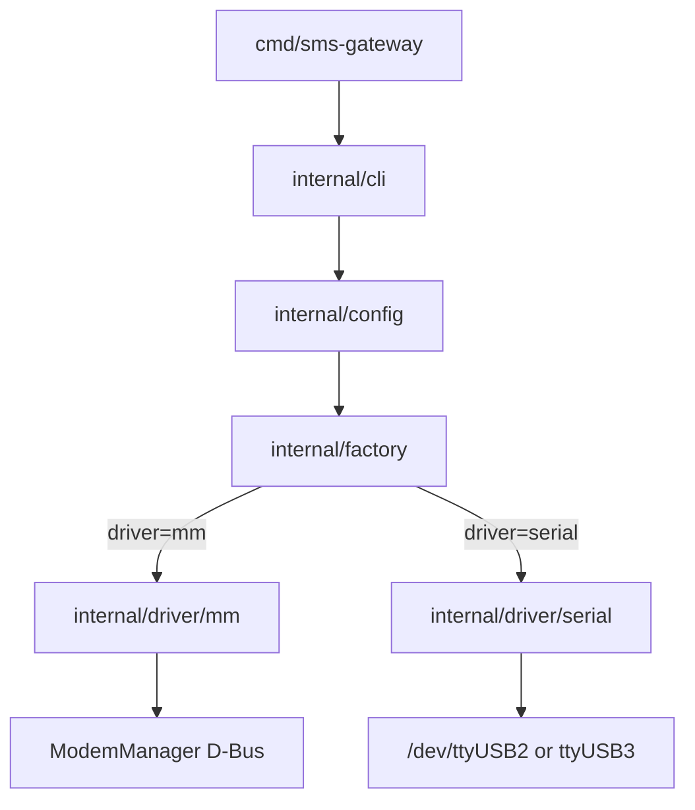

# SMS Gateway

SMS gateway for receiving SMS messages on Linux using a **Quectel EC25-EUX** LTE modem connected over USB.

Single static binary with subcommands — ideal for headless Raspberry Pi deployment.

```bash
make
./bin/sms-gateway ping
./bin/sms-gateway status
./bin/sms-gateway ports
```

The project uses a pluggable **driver** model to talk to the modem:

| Driver | Backend | Default |
|--------|---------|---------|
| **`mm`** | ModemManager over system D-Bus | **yes** |
| **`serial`** | Direct AT commands on `/dev/ttyUSB*` | no |

## Architecture



Both drivers implement `internal/modem.Modem` (`Ping`, `SMSStatus`, `ListMessages`, `SendMessage`, `Close`).

Forward channels (Telegram, email, SMS, …) implement `internal/forward.Channel` with the same factory pattern as modem drivers.

## Commands

| Command | Description |
|---------|-------------|
| `ping` | Check modem connectivity |
| `status` | Show SIM and SMS readiness |
| `messages` | List all SMS messages |
| `messages prune` | Free modem storage slots holding already-forwarded SMS |
| `send` | Send an SMS (`--number`, `--text`) |
| `modems list` | List configured modems; `--discover` shows ModemManager indices |
| `channel test` | Send a test message via a forward channel (e.g. Telegram) |
| `ports` | List detected serial ports |

Global flags (all subcommands):

```
--config string    Config file path
--driver string    Driver override: mm | serial
-v, --verbose      Verbose logging
```

Subcommand flags (`ping`, `status`, `messages`, `send`):

```
--modem string        Named modem from config modems map
--device string       Serial device (serial driver only)
--timeout duration    Command timeout
--modem-index int     ModemManager modem index (mm driver only)
```

### Multi-modem setups

When the `modems` section is configured (see [`config.example.yaml`](config.example.yaml)), `ping`, `status`, and `messages` run against **all** configured modems by default. Use `--modem NAME` to target one modem.

```bash
./bin/sms-gateway ping                         # all modems
./bin/sms-gateway status --modem ec25-main     # one modem
./bin/sms-gateway modems list --discover       # help map mmcli indices to config
```

For `send`, specify `--modem` when multiple modems are configured (or set `default_modem` in config).

Without a `modems` section, commands use the legacy top-level `driver` / `mm` / `serial` settings (single modem).

## Hardware

| Component | Details |
|-----------|---------|
| Modem | Quectel EC25-EUX (USB VID `2c7c`, PID `0125`) |
| Connection | USB to host computer |
| SIM | Required for SMS later; **not** required for ping PoC |

Typical USB interfaces exposed by the EC25 on Linux:

| Device | Purpose |
|--------|---------|
| `/dev/ttyUSB0` | Diagnostic (DM) |
| `/dev/ttyUSB1` | GPS NMEA |
| `/dev/ttyUSB2` | AT commands (primary) |
| `/dev/ttyUSB3` | AT / PPP |
| `/dev/cdc-wdm*` | QMI |
| `wwan0` | Network interface |

## Configuration

Copy the example config:

```bash
cp config.example.yaml config.yaml
```

Example [`config.example.yaml`](config.example.yaml):

```yaml
driver: mm   # mm | serial

serial:
  device: auto
  baud_rate: 115200
  timeout: 2s

mm:
  modem_index: 0
  timeout: 5s
```

**Precedence** (highest wins): CLI flags → environment variables → YAML file → built-in defaults.

| Setting | YAML | Environment | CLI flag |
|---------|------|-------------|----------|
| Config file | — | `SMS_GATEWAY_CONFIG` | `--config` |
| Driver | `driver` | `SMS_GATEWAY_DRIVER` | `--driver` |
| Serial device | `serial.device` | `MODEM_DEVICE` | `--device` |
| Timeout | `serial.timeout` / `mm.timeout` | `MODEM_TIMEOUT` | `--timeout` |
| MM modem index | `mm.modem_index` | `MODEM_INDEX` | `--modem-index` |
| Named modem | `modems.<name>` | — | `--modem` |

Config search order: `--config` path → `./config.yaml` → `/etc/sms-gateway/config.yaml` (skipped if missing).

### Forwarding

Optional sections in [`config.example.yaml`](config.example.yaml):

| Section | Purpose |
|---------|---------|
| `modems` | Named modems for multi-SIM setups (hardware settings) |
| `sim_numbers` | ICCID → MSISDN map (SIM-centric line identity) |
| `channels` | Named forward destinations (Telegram bot, email, SMS, …) |
| `forward_rules` | Route inbound SMS: optional `modem` + `from` + `to_line` → `to: [channels]` (first match wins) |

`to_line` matches the recipient MSISDN from `sim_numbers` (`*` or omitted = any line, including unmapped SIMs). Prefer `to_line` over `modem` so routing survives SIM swaps.

**Channel drivers:**

| Driver | Status |
|--------|--------|
| `telegram_bot` | Implemented — Bot API private chat |
| `telegram_secret` | Planned — Secret Chat (E2E) |
| `email` | Planned |
| `sms` | Planned — forward by sending SMS to another number |

**Telegram setup:**

1. Create a bot via [@BotFather](https://t.me/BotFather) → copy `bot_token`.
2. Open a chat with the bot and send `/start`.
3. Get your `chat_id` (`curl "https://api.telegram.org/bot<TOKEN>/getUpdates"` after `/start`).
4. Set token via env (recommended): `SMS_GATEWAY_CHANNEL_MY_TELEGRAM_BOT_TOKEN` or `SMS_GATEWAY_TELEGRAM_BOT_TOKEN`.
5. Optional `telegram.proxy_url` (e.g. `socks5://127.0.0.1:1080`) when Bot API is blocked — use with SSH `-D` tunnel.

**Test channel:**

```bash
sms-gateway channel test my-telegram
sms-gateway channel test my-telegram --text "Hello from Pi" -v
```

**Security:** Bot API uses TLS to Telegram, but SMS text is **visible to Telegram** (cloud chat, not Secret Chat). For maximum privacy, a future `telegram_secret` driver is planned.

### Watch daemon (`sms-gateway-watch`)

Separate long-running binary: listen for incoming SMS on all `modems`, persist to SQLite, apply `forward_rules`, fan-out to `channels`.

```bash
go build -o bin/sms-gateway-watch ./cmd/sms-gateway-watch
./bin/sms-gateway-watch -v
```

Requires `modems`, `channels`, `forward_rules`, and `storage.path` in config (see [`config.example.yaml`](config.example.yaml)).

| Setting | Description |
|---------|-------------|
| `storage.path` | SQLite database for messages and delivery state |
| `watch.catch_up_on_start` | Forward existing inbound SMS on startup |
| `watch.serial_poll_interval` | Poll interval for `serial` modems (default 10s) |
| `watch.delete_after_forward` | Free the modem storage slot once every channel is delivered (default off) |
| `watch.reconnect_initial` | First delay before reopening a failed modem (default 2s) |
| `watch.reconnect_max` | Cap on the reconnect backoff; retried at this interval forever (default 60s) |
| `watch.stall_timeout` | Report a connected modem that has not completed a poll in this long (default 5m) |
| `watch.health_interval` | How often to log a `modem_health` heartbeat per modem (default 30m) |
| `alerts.after` | Report a modem silent this long (default 5m) |
| `alerts.channels` | Channels operational alerts go to; empty switches alerting off |

**Modem backends:**

| Driver | Detection |
|--------|-----------|
| `mm` | ModemManager D-Bus `Messaging.Added` signal |
| `serial` | Poll `ListMessages` (cannot run while MM holds the same port) |

**systemd:**

```bash
sudo cp bin/sms-gateway-watch /usr/local/bin/
sudo cp deploy/systemd/sms-gateway-watch.service /etc/systemd/system/
sudo systemctl enable --now sms-gateway-watch
```

### Raspberry Pi (serial, no ModemManager)

Config lives on the Pi at `~/smsgateway/config.yaml` (not in git; excluded from `rsync`). Use serial driver for each modem in the `modems` map and a catch-all forward rule (`from: "*"`, no `modem` field).

**Deploy code from dev machine:**

```bash
rsync -avz --exclude='bin/' --exclude='config.yaml' ./ first_pi:~/smsgateway
```

**On the Pi:**

```bash
export SMS_GATEWAY_CHANNEL_MY_TELEGRAM_BOT_TOKEN=your-token-here
cd ~/smsgateway && make build

./bin/sms-gateway ping --modem ec25-main
./bin/sms-gateway ping --modem ec25-backup
./bin/sms-gateway channel test my-telegram --text "Pi serial OK"
./bin/sms-gateway-watch -v
```

If a port is **busy**, stop the watch daemon first (`pkill sms-gateway-watch`). If `ec25-main` fails on `/dev/ttyUSB2`, try `/dev/ttyUSB3` in config.

### Telegram via SSH tunnel (Russia / blocked regions)

> Not needed when the network's gateway already routes blocked destinations
> abroad, e.g. a split tunnel on the router. Check first: if `curl
> https://api.telegram.org/` answers from the device, `proxy_url` only adds a
> hop. It is worth confirming the tunnel is a genuinely independent path and not
> one whose own packets ride over that same gateway — if it is not, it adds a
> failure mode without adding a fallback.

When `api.telegram.org` is unreachable, route Bot API traffic through a SOCKS proxy created by SSH to an outside VPS.

1. Create tunnel user on VPN and deploy key (see [`deploy/systemd/sms-tunnel.service`](deploy/systemd/sms-tunnel.service)).
2. On Pi config, set `channels.my-telegram.telegram.proxy_url: socks5://127.0.0.1:1080`.
3. Start tunnel: `sudo systemctl enable --now sms-tunnel` (or manual `ssh -N -D 127.0.0.1:1080 ...`).
4. Env template: [`deploy/env.pi.example`](deploy/env.pi.example). Pi watch unit: [`deploy/systemd/sms-gateway-watch.pi.service`](deploy/systemd/sms-gateway-watch.pi.service).

## Prerequisites

- Linux with Quectel USB drivers (`option`, `qmi_wwan`)
- Go **1.26** or newer
- **`mm` driver:** `ModemManager` running (`systemctl status ModemManager`)
- **`serial` driver:** user in `dialout` group

### Install Go 1.26

```bash
curl -fsSL -o /tmp/go1.26.0.linux-amd64.tar.gz https://go.dev/dl/go1.26.0.linux-amd64.tar.gz
mkdir -p ~/.local/go1.26 && tar -C ~/.local/go1.26 --strip-components=1 -xzf /tmp/go1.26.0.linux-amd64.tar.gz
export PATH=$HOME/.local/go1.26/bin:$PATH
go version
```

### Serial port permissions (serial driver only)

```bash
sudo usermod -aG dialout $USER
# log out and back in
```

## Quick start

```bash
# Build
go build -o bin/sms-gateway ./cmd/sms-gateway

# Ping modem (default: ModemManager driver)
./bin/sms-gateway ping

# Check SIM and SMS readiness
./bin/sms-gateway status

# List all SMS messages
./bin/sms-gateway messages

# Send an SMS
./bin/sms-gateway send --number +1234567890 --text "Hello"

# Serial AT driver with verbose logging
./bin/sms-gateway --driver serial ping -v

# Env override
SMS_GATEWAY_DRIVER=serial ./bin/sms-gateway ping

# List serial ports
./bin/sms-gateway ports

# Help
./bin/sms-gateway --help
./bin/sms-gateway ping --help
```

Development without installing:

```bash
go run ./cmd/sms-gateway ping
go run ./cmd/sms-gateway status
```

Expected output (`ping`, MM driver):

```
driver: mm
device: /org/freedesktop/ModemManager1/Modem/0
status: ok
detail: QUALCOMM INCORPORATED QUECTEL Mobile Broadband Module (IMEI ..., state ...)
```

Expected output (`status`, MM driver):

```
driver: mm
device: /org/freedesktop/ModemManager1/Modem/0
sim: missing
modem: failed (sim-missing)
network: unavailable
messages: unknown
sms_ready: false
detail: sim=missing, modem=failed (sim-missing), network=unavailable
```

### Exit codes

| Code | Meaning |
|------|---------|
| 0 | Command succeeded |
| 1 | Modem operation failed |
| 2 | Setup failure (config, permissions, driver init) |

## Driver comparison

| | **mm** (default) | **serial** |
|--|------------------|------------|
| Best for | Headless Pi, desktop with MM | Dedicated gateway, full AT control |
| Permissions | D-Bus / polkit (usually works for session user) | `dialout` group |
| Port busy issue | No serial port opened | May need `auto` fallback or udev rule |
| Pi OS Bookworm | Works out of the box | Works with `dialout` |

## Troubleshooting

### MM driver: modem not found

- Check ModemManager: `systemctl status ModemManager`
- List modems: `mmcli -L`
- Try explicit path in config: `mm.modem_path: /org/freedesktop/ModemManager1/Modem/0`

### Serial driver: Serial port busy

ModemManager holds `/dev/ttyUSB2`. Use default `auto` device probing (tries `ttyUSB2` then `ttyUSB3`) or install the udev rule:

```bash
sudo cp deploy/udev/99-quectel-at.rules /etc/udev/rules.d/
sudo udevadm control --reload-rules && sudo udevadm trigger
```

Or use the **mm** driver (default) to avoid serial port contention entirely.

### SIM not detected (`sim-missing`)

Blocks SMS but not ping. Reseat the nano-SIM and check `mmcli -m 0 | grep -i sim`.

### Modem storage full: incoming SMS stop arriving

An EC25 holds 255 messages. Once `status` reports `messages: ME 255/255` the modem
**refuses new SMS outright** — they are not queued and they do not arrive late. Nothing
in the gateway raises an alarm, so the first symptom is silence on that line.

```bash
./bin/sms-gateway status --modem ec25-main   # messages: ME 255/255
```

Set `watch.delete_after_forward: true` so the daemon frees each slot once every channel
for that message is delivered. The slot is freed only after a *recorded successful*
delivery, and `sms.db` keeps the message, so freeing it loses no history. A message that
matches no forward rule is never deleted.

To clear an existing backlog by hand:

```bash
./bin/sms-gateway messages prune --modem ec25-main           # dry run
./bin/sms-gateway messages prune --modem ec25-main --yes     # delete them
```

`prune` consults `storage.path` and only deletes slots the database shows as delivered
on every channel; `--all` additionally deletes slots with no confirmed delivery.

### Being told when a modem dies

The journal shows an outage, but only if somebody is reading it. With `alerts`
configured, a modem that has gone `alerts.after` without a successful poll is
reported once:

```
sms-gateway PROBLEM
modem ec25-main has not polled for 5m2s

SMS to that SIM are not being received.
```

and when it starts polling again:

```
sms-gateway RECOVERED
modem ec25-main is polling again after 7m14s
```

One message per outage, not one per check, and the recovery reports the whole
outage rather than its tail. A modem that has never polled is measured from
daemon start, so a restart does not read as an outage stretching back to the
epoch.

A failed send is retried on the next check rather than dropped — Telegram being
unreachable is a plausible reason the gateway is in trouble in the first place —
and a queued alert is flushed on shutdown, so a restart does not swallow the
alert explaining why the restart was needed.

The decision and the delivery are separate on purpose. `internal/alert` decides
(pure, no clock, no I/O, no Telegram) and `alert.Notifier` delivers. Today that
is `ChannelNotifier`, writing to the forward channels named in
`alerts.channels`; a standalone notification service replaces it by implementing
`Notifier`, and the policy does not move.

### A SIM goes silent while the daemon looks healthy

Before the liveness work, any error inside a modem's watch loop — a USB re-enumeration,
a read timeout, a modem that stopped answering AT — ended that modem's goroutine for
good. The process stayed up serving the *other* modem, so `systemctl is-active` reported
`active`, `Restart=on-failure` never fired, and that SIM received nothing until someone
restarted the service by hand.

The daemon now supervises each modem: a failed watch loop is closed and reopened with
exponential backoff (`reconnect_initial` → `reconnect_max`), retried forever, and every
reconnect re-lists modem storage so messages that arrived while the port was down are
still picked up. One modem can no longer take another down with it.

What that looks like in the journal:

| Line | Meaning |
|------|---------|
| `modem_down modem=X uptime=… retry_in=…` | Watch loop exited; reconnect scheduled |
| `modem_up modem=X (reconnected)` | Port reopened and watching again |
| `modem_stalled modem=X last_poll=…` | Port is open but no poll has completed in `stall_timeout` |
| `modem_recovered modem=X` | Polling resumed after a stall |
| `modem_health modem=X state=up last_poll=… polls=N reconnects=N` | Heartbeat, every `health_interval` |
| `modem_abandoned modem=X` | Not retryable (unsupported driver); fix the config |
| `ingest_failed modem=X id=N` | One message could not be processed; the rest of the batch continued |
| `channel_missing modem=X channel=Y` | A forward rule names a channel that is not configured |

To confirm reception is alive right now:

```bash
journalctl -u sms-gateway-watch --since "-1h" | grep -E "modem_health|modem_down|modem_stalled"
```

A modem that is working logs `modem_health … state=up` with a small `last_poll` and a
`polls` count that keeps climbing. `reconnects` counts how often it has had to recover —
a number that grows steadily points at the hardware or the USB cable, not the daemon.

Two deliberate choices sit behind this:

- The unit uses `Wants=sms-tunnel.service`, **not** `Requires=`. The tunnel is only how
  messages leave the Pi; binding reception to it meant every tunnel restart also stopped
  the gateway.
- `Restart=always` with `StartLimitIntervalSec=0`. A clean exit still means no SMS are
  arriving, and the default start limit gives up after 5 restarts in 10s.

## Project layout

```
cmd/sms-gateway/          Single binary entrypoint
internal/cli/             Cobra commands (ping, status, messages, send, ports)
internal/cmdutil/         Shared flags and modem helpers
internal/config/          YAML + env + flag loading
internal/modem/           Modem interface and types
internal/factory/         Driver factory
internal/driver/mm/       ModemManager D-Bus driver (Linux)
internal/driver/serial/   Direct AT serial driver
internal/forward/         Forward channel interface, router, factory
internal/forward/telegrambot/  Telegram Bot API driver
internal/storage/         SQLite message and delivery store
internal/watch/           Watch daemon orchestration
internal/alert/           Modem outage policy and alert delivery
cmd/sms-gateway-watch/    Watch daemon binary
config.example.yaml       Example configuration
deploy/env.pi.example     Pi env file template (bot token)
deploy/systemd/           systemd units (watch daemon, SSH tunnel)
deploy/udev/              Optional udev rules for serial driver
test/integration/         Serial lab: real driver against a pseudo-terminal
.github/workflows/ci.yml  CI: gofmt, build, vet, race tests, arm64 cross-build, lab
```

### The serial lab

`make test-integration` runs the real serial driver against a fake EC25 that
speaks AT over a pseudo-terminal, reached through a device node the test can
delete and recreate. That is the one thing the unit tests cannot reach: they
prove the supervisor reconnects when a *fake* modem returns an error, not when
the device node vanishes and comes back as a different `pts` — which is what a
USB re-enumeration does, and is the failure that took a SIM out of service.

It is behind the `integration` build tag and needs `/dev/ptmx`, so `make test`
does not run it. The lab fails rather than skips when `/dev/ptmx` is missing: a
lab that skips itself looks green while covering nothing.

Every push to `master` and every pull request runs the same five checks you can
run locally:

```bash
gofmt -l . && go build ./... && make vet && go test ./... -race && GOOS=linux GOARCH=arm64 go build ./cmd/...
make test-integration
```

The race detector is not optional here: the watch daemon runs one goroutine per
modem plus a health reporter over shared state. The arm64 cross-build guards the
only machine that actually matters, the Pi.

## Roadmap

1. **PoC (done)** — `ping`, `status`, `messages`, `send`
2. **Forward channels (done)** — pluggable channels, routing rules, `channel test`, `telegram_bot`
3. **Watch daemon (done)** — `sms-gateway-watch`, SQLite persistence, MM D-Bus + serial poll
4. More channel drivers — `telegram_secret`, `email`, `sms`
5. HTTP/API gateway — expose SMS to other services

## License

Private project — license TBD.
